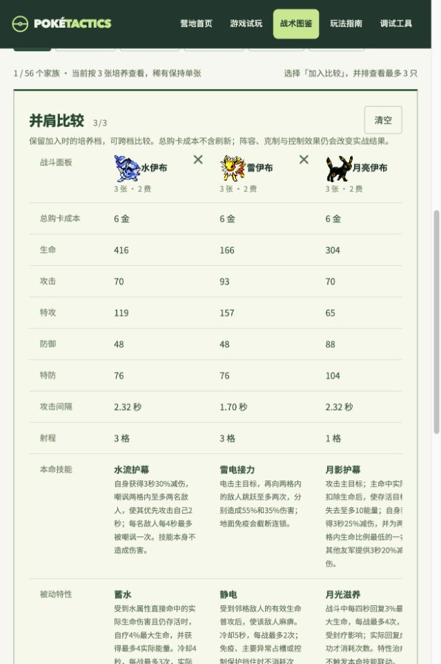

# 家族卡池第一版与强度图鉴

状态：2026-10-17 已实施。替代 50 号文档中「尚未实施」的原型状态；该文档的旧池统计保留作历史对照。

## 使用入口

- `/pokedex`：56 个家族、120 个战斗形态；切换累计 1 / 3 / 9 张，按费用、定位、名称筛选，按面板排序，最多三只并排比较。
- `/play`：新开竞技局启用 `families_v1`。已有对局继续 `species_v1`，恢复不会把现有棋子强制迁移。经典模式不变。
- 图鉴面板复用实际部署计算，包含家族费用预算、培养倍率和定位修正，不含装备、羁绊、海克斯和开战被动；攻击间隔越短行动越快。总成本只计购买，不含刷新与占格成本。

## 共同培养规则

商店只卖每个家族的入口形态，家族费用不会随进化变化。三个同培养档、同路线实例合成下一档，累计投入 1 / 3 / 9 张。合成不再从终态扣额外库存，卖出和淘汰按来源退回入口池。

- 小火龙（2 费）：小火龙 → 火恐龙 → 喷火龙；总购买成本 2 / 6 / 18 金。进化后商店仍卖小火龙。
- 鲤鱼王（2 费）：鲤鱼王 → 暴鲤龙 → 暴鲤龙满培养；成本同上。
- 拉普拉斯（3 费）：同形态的初始 / 进阶 / 满培养；总购买成本 3 / 9 / 27 金。
- 迷你龙（3 费）：迷你龙 → 哈克龙 → 快龙，退出稀有限一。
- 三神鸟（4 费）、超梦和梦幻（5 费）共用全队一只的稀有限额，不参与培养。

自然形态数量不决定投入上限。战斗先按费用预算分配属性，再应用一次培养倍率；不会额外叠加原作 BST 总量增长。相同预算仍可能因属性分配、技能和配队表现不同，尚不能据此宣称已平衡。

合成优先保留场上靠前的材料 UID 和首件装备；其余装备退回库存，首个兼容技能保留，多余或不兼容技能退为技能机。目标形态不支持的可选特性回到目标默认。合成产物进入备战席，容量不足时购买或手动分支选择整体失败，不消耗材料。

## 伊布：在进化时决定战术

伊布是一个 2 费家族，五条路线共用 22 张库存与一个抽取权重。集齐三只初始伊布后不会自动选路；准备期打开个体详情，查看各分支技能后主动选择。

| 分支 | 第一版战术职责 |
| --- | --- |
| 水伊布 | 防守，嘲讽附近敌人并减伤 |
| 雷伊布 | 攻击，电属性连锁伤害 |
| 火伊布 | 攻击，火属性范围伤害 |
| 太阳伊布 | 攻击，接易伤目标的念力追击 |
| 月亮伊布 | 防守，削减目标能量并保护队友 |

进化后路线锁定。三个同分支进阶实例才能满培养，总计九张入口卡；不同分支不会互相吞并，也不能无成本变换。同家族不同分支可同时上场，各自占人口；对每项羁绊同家族最多贡献一次，不同属性可各贡献一次。

AI 优先补已有进阶分支，其次选匹配目标属性的路线。无畏小子使用相同选择机制，当前精选池支持飞腿郎与战舞郎；未宣称覆盖全部自然分支。

## 首轮卡池

费用、库存均为试玩初值。每个非空物种仍按原商店规则等权抽取，未改成按剩余张数加权。库存增加缓解多人争抢，不会直接提高指定家族的出现率。

| 费用 | 可抽家族 | 每族库存 | 基础牌总数 |
| --- | ---: | ---: | ---: |
| 1 | 14 | 24 | 336 |
| 2 | 22 | 22 | 484 |
| 3 | 15 | 18 | 270 |
| 4 | 3 | 10 | 30 |
| 5 | 2 | 8 | 16 |
| 合计 | 56 | — | 1136 |

| 入口 | 费用 | 每族库存 | 支持路线 |
| --- | ---: | ---: | --- |
| 绿毛虫 | 1 | 24 | 绿毛虫 → 铁甲蛹 → 巴大蝶 |
| 尼多兰 | 1 | 24 | 尼多兰 → 尼多娜 → 尼多后 |
| 腕力 | 1 | 24 | 腕力 → 豪力 → 怪力 |
| 小拳石 | 1 | 24 | 小拳石 → 隆隆石 → 隆隆岩 |
| 大舌头 | 1 | 24 | 大舌头 |
| 蔓藤怪 | 1 | 24 | 蔓藤怪 |
| 尾立 | 1 | 24 | 尾立 → 大尾立 |
| 咕咕 | 1 | 24 | 咕咕 → 猫头夜鹰 |
| 灯笼鱼 | 1 | 24 | 灯笼鱼 → 电灯怪 |
| 皮丘 | 1 | 24 | 皮丘 → 皮卡丘 → 雷丘 |
| 宝宝丁 | 1 | 24 | 宝宝丁 → 胖丁 → 胖可丁 |
| 乌波 | 1 | 24 | 乌波 → 沼王 |
| 千针鱼 | 1 | 24 | 千针鱼 |
| 无畏小子 | 1 | 24 | 无畏小子 → 飞腿郎；无畏小子 → 战舞郎 |
| 妙蛙种子 | 2 | 22 | 妙蛙种子 → 妙蛙草 → 妙蛙花 |
| 小火龙 | 2 | 22 | 小火龙 → 火恐龙 → 喷火龙 |
| 杰尼龟 | 2 | 22 | 杰尼龟 → 卡咪龟 → 水箭龟 |
| 尼多朗 | 2 | 22 | 尼多朗 → 尼多力诺 → 尼多王 |
| 走路草 | 2 | 22 | 走路草 → 臭臭花 → 霸王花 |
| 卡蒂狗 | 2 | 22 | 卡蒂狗 → 风速狗 |
| 玛瑙水母 | 2 | 22 | 玛瑙水母 → 毒刺水母 |
| 鬼斯 | 2 | 22 | 鬼斯 → 鬼斯通 → 耿鬼 |
| 大岩蛇 | 2 | 22 | 大岩蛇 → 大钢蛇 |
| 吉利蛋 | 2 | 22 | 吉利蛋 → 幸福蛋 |
| 魔墙人偶 | 2 | 22 | 魔墙人偶 |
| 凯罗斯 | 2 | 22 | 凯罗斯 |
| 鲤鱼王 | 2 | 22 | 鲤鱼王 → 暴鲤龙 |
| 伊布 | 2 | 22 | 伊布 → 水伊布；伊布 → 雷伊布；伊布 → 火伊布；伊布 → 太阳伊布；伊布 → 月亮伊布 |
| 皮宝宝 | 2 | 22 | 皮宝宝 → 皮皮 → 皮可西 |
| 咩利羊 | 2 | 22 | 咩利羊 → 茸茸羊 → 电龙 |
| 黑暗鸦 | 2 | 22 | 黑暗鸦 |
| 梦妖 | 2 | 22 | 梦妖 |
| 赫拉克罗斯 | 2 | 22 | 赫拉克罗斯 |
| 狃拉 | 2 | 22 | 狃拉 |
| 迷唇娃 | 2 | 22 | 迷唇娃 → 迷唇姐 |
| 电击怪 | 2 | 22 | 电击怪 → 电击兽 |
| 凯西 | 3 | 18 | 凯西 → 勇基拉 → 胡地 |
| 呆呆兽 | 3 | 18 | 呆呆兽 → 呆壳兽 |
| 大舌贝 | 3 | 18 | 大舌贝 → 刺甲贝 |
| 墨海马 | 3 | 18 | 墨海马 → 海刺龙 → 刺龙王 |
| 海星星 | 3 | 18 | 海星星 → 宝石海星 |
| 飞天螳螂 | 3 | 18 | 飞天螳螂 → 巨钳螳螂 |
| 肯泰罗 | 3 | 18 | 肯泰罗 |
| 拉普拉斯 | 3 | 18 | 拉普拉斯 |
| 化石翼龙 | 3 | 18 | 化石翼龙 |
| 迷你龙 | 3 | 18 | 迷你龙 → 哈克龙 → 快龙 |
| 菊草叶 | 3 | 18 | 菊草叶 → 月桂叶 → 大竺葵 |
| 火球鼠 | 3 | 18 | 火球鼠 → 火岩鼠 → 火暴兽 |
| 小锯鳄 | 3 | 18 | 小锯鳄 → 蓝鳄 → 大力鳄 |
| 盔甲鸟 | 3 | 18 | 盔甲鸟 |
| 幼基拉斯 | 3 | 18 | 幼基拉斯 → 沙基拉斯 → 班基拉斯 |
| 急冻鸟 | 4 | 10 | 急冻鸟 |
| 闪电鸟 | 4 | 10 | 闪电鸟 |
| 火焰鸟 | 4 | 10 | 火焰鸟 |
| 超梦 | 5 | 8 | 超梦 |
| 梦幻 | 5 | 8 | 梦幻 |

## 数据与实现边界

本版接入现有第一、第二世代精选家族及缺失前置，新增 20 个前置物种的数据和 40 张普通／闪光贴图，尚未完整导入前三世代。原经典资料与 84 形态池不因补数据扩大。

新增资料取自 `pret/pokecrystal`，固定提交 `7a7881d0d62e0ddbd82dcf10e7116807487ac651`；图像取 PokeAPI 的 Crystal 资源并按项目格式转换。逐文件来源和哈希见 `assets/gen2/family_sources.json`，数据见 `data/pokemon_family_preforms.json`。招式编号按 `NO_MOVE = 0` 解码，兼容汇编学习表中的对齐空格。

本轮重点为可玩的家族经济、分支与比较工具。新增前置使用通用属性攻击或家族支援技能，部分特性和伊布新增分支机制复用现有内容，标为家族原型特性；尚未逐种完成最终技能与专属演出。费用、技能质变、三张成型时间、备战占用、九张追牌率和各分支胜率需要后续多人多种子平衡实验。

## 回归范围

`tests/test_arena_families.py` 覆盖抽卡入口、三类链长度的 1/3/9 培养、来源和卖出守恒、五分支、跨分支拒绝、满席原子性、资源继承、AI、羁绊去重、真实部署面板、全形态渲染目录、旧档恢复与伪造存档拒绝，并推进六轮实际 PVP/PVE 后逐轮存取档。

额外运行竞技、存档、门户与对局前端回归。浏览器验收搜索、培养档、伊布分支和三只对照，窄窗口表格可横向滚动。测试通过代表功能与兼容性范围，不代表胜率平衡已达成。

本轮最终记录：竞技 650 项、存档 12 项、门户 10 项、对局前端 6 项均通过，JavaScript 语法与 `git diff --check` 通过。独立临时存档目录中的浏览器对局已实际完成三只伊布 → 雷伊布，刷新后保留进化与分支锁定；未修改用户原有对局。

