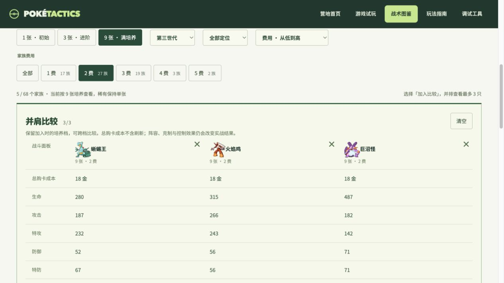

# 前三世代资料与丰缘竞技扩展

本轮把原作资料扩到 386 种，并将竞技池从 56 家族扩到 68 家族、151 个可部署形态。资料收录和竞技准入分别维护，尚未配置技能与费用的物种不进入商店。

## 体验入口

- `/pokedex?generation=3`：12 个丰缘家族，切换 1 / 3 / 9 张培养，查看实际战斗面板并加入比较。
- `/pokedex?view=all`：前三世代全部 386 种资料，支持名称、编号、属性、世代及竞技收录筛选。
- `/pokedex?pool=families_v1`：旧对局的 56 家族面板；对局中的图鉴链接带当前池版本。
- `/play`：新开竞技局使用 `families_v2`，已有局保留自己的池版本。

资料页采用第三世代历史属性与种族值，不使用后续世代妖精属性或数值加强，也不列出第四世代以后的进化。自然进化关系和当前精选竞技路线分开展示，例如资料中的玛力露可追溯到露力丽，但未配置竞技家族就不会出现在商店。

## 新加入的 12 个家族

| 商店入口与路线 | 费用 | 成型职责 |
| --- | ---: | --- |
| 木守宫 → 森林蜥蜴 → 蜥蜴王 | 2 | 草属性连击，接易伤追击 |
| 火稚鸡 → 力壮鸡 → 火焰鸡 | 2 | 火焰范围攻击转近战连踢与击退 |
| 水跃鱼 → 沼跃鱼 → 巨沼怪 | 2 | 水流贯穿、泥沼阻截与减伤前排 |
| 莲叶童子 → 莲帽小童 → 乐天河童 | 1 | 治疗、回能与雨天配队 |
| 拉鲁拉丝 → 奇鲁莉安 → 沙奈朵 | 3 | 解控回能转屏障保护 |
| 蘑蘑菇 → 斗笠菇 → 满培养斗笠菇 | 1 | 孢子与格斗连击 |
| 可可多拉 → 可多拉 → 波士可多拉 | 1 | 钢甲击退与减伤前排 |
| 青绵鸟 → 七夕青鸟 → 满培养七夕青鸟 | 2 | 云羽护盾转团队治疗 |
| 丑丑鱼 → 美纳斯 → 满培养美纳斯 | 2 | 弱起手扑击，进化转水系治疗 |
| 阿勃梭鲁：初始 → 进阶 → 满培养 | 3 | 恶属性爆发，接已有易伤 |
| 宝贝龙 → 甲壳龙 → 暴飞龙 | 3 | 击退清场转龙系俯冲 |
| 铁哑铃 → 金属怪 → 巨金怪 | 3 | 击退、减伤与抗威吓 |

三段、两段与单形态继续使用同一套累计 1 / 3 / 9 张规则，费用固定，商店始终出售入口形态。进化保留来源账本，卖出和淘汰按入口返还库存。伊布五分支规则不变。

新形态拥有原生技能与特性定义，机制复用已有的伤害、连击、击退、护盾、净化、治疗与天气触发链。特性是竞技改编，以页面触发说明为准。新形态演出使用属性通用效果；这轮没有完成 31 种形态各自的骨骼动画或独立逐帧动画。

## 卡池分布与获取难度

| 费用 | v1 家族 | v2 家族 | 每族库存 | v2 基础牌 |
| --- | ---: | ---: | ---: | ---: |
| 1 | 14 | 17 | 24 | 408 |
| 2 | 22 | 27 | 22 | 594 |
| 3 | 15 | 19 | 18 | 342 |
| 4 | 3 | 3 | 10 | 30 |
| 5 | 2 | 2 | 8 | 16 |
| 合计 | 56 | 68 | — | 1390 |

本轮保留等级出费概率和非空家族等权抽取规则。扩大卡池会降低追指定家族的概率，新增库存不会抵消这点。以池未枯竭时为例：

- 2 级商店单格命中特定 1 费：`1/14 → 1/17`，约 `7.14% → 5.88%`。
- 5 级商店单格命中特定 2 费：`40%/22 → 40%/27`，约 `1.82% → 1.48%`。
- 7 级商店单格命中特定 3 费：`30%/15 → 30%/19`，约 `2.00% → 1.58%`。

这些是单格条件概率，不是九张成型率；共享池枯竭、刷新、等级与其他训练家购买都会改变实际结果。费用和数值仍是试玩初值，后续平衡应重点看三张首次成型轮次、九张追牌成本、前期备战占用、辅助换形后的战力变化与分支胜率。

## 数据、素材与兼容

- `data/pokemon_gen123_reference.json`：386 种第三世代历史资料，独立于经典 151 种与旧竞技 62 物种表。原经典 84 模板不扩大。
- `tools/build_gen123_reference.py`：固定来源提交、导入历史 CSV 与素材，记录来源和哈希。PokeAPI 招式 ID 使用独立字段，不当作项目运行时招式 ID。
- 第二世代补齐 58 种普通／闪光素材，保留已有 42 种素材；第三世代新增 135 种普通／闪光 RGBA 素材。Gen3 保留内部白色，不套用旧素材的色号 0 去背景逻辑。
- `families_v1`、`families_v2` 的入口、模板、库存、图鉴均按版本读取。精确前任规则指纹允许恢复，但不能伪装成新池或在旧池注入丰缘棋子。
- `tests/fixtures/family-v1-pre-gen3.json` 是改规则前生成的真实存档，包含进化后个体。回归要求恢复后除规则指纹外所有已保存字段不变。
- 整局抽样同时修正了迷唇娃旧前置数据中的 `PSYCHIC_TYPE` 标记，规范成运行时的 `PSYCHIC`，避免遇到该单位时属性克制计算报错。

## 验证范围

竞技回归 `test_arena*.py` 共 672 项通过；额外通过资料扩展 10 项、目录集成 5 项、角色目录 7 项、存档 12 项、入口及版本化特性／羁绊目录 14 项、试玩 6 项，共 726 项。四份前端脚本通过 `node --check`，`git diff --check` 通过。

扩展回归覆盖 386 种资料与素材、历史属性和跨代进化关系、两个池版本的目录与库存、旧档原样恢复及伪造拒绝、新技能真实施法、新家族合成出售、多轮 PVP/PVE 存取档、图鉴 API 和渲染预览。功能回归通过不代表胜率平衡已经完成。

数据已通过固定版本的 PokeAPI 下载路径重新生成，输出逐字节一致；386 种的种族值和属性全部通过固定 `pret/pokeemerald` 提交的交叉核对。素材覆盖 Gen2 普通／闪光各 100 张、Gen3 各 135 张，原有 84 张 Gen2 文件逐字节未变。

稳定性抽样使用种子 2401–2410，7 名 AI 自然招募，玩家固定部署绿毛虫、尼多兰、腕力和小拳石的一阶阵容；关闭逐帧写盘但保留真实战斗与准备结算。修正迷唇娃属性后，10 局均在第 27–29 回合自然结束，无运行异常，12 个丰缘家族均被 AI 招募。这只证明该抽样条件下的稳定性和招募覆盖，不代表人类操作下的成型速度或公平胜率。

浏览器已验收世代筛选、培养档、御三家三只比较、386 资料分页、编号搜索、沙奈朵第三世代超能属性，以及旧池排除丰缘候选；特性与羁绊目录也按对应卡池展示，跨栏目保留旧池版本。在隔离测试存档中，真实点击招募第三只水跃鱼后自动合成为二阶沼跃鱼，金币由 7 降至 5；刷新页面后沼跃鱼与金币均正确恢复。巨沼怪「潮泥重炮」动画实验室预览成功生成 37 帧，并明确标注当前使用通用整身动作。

