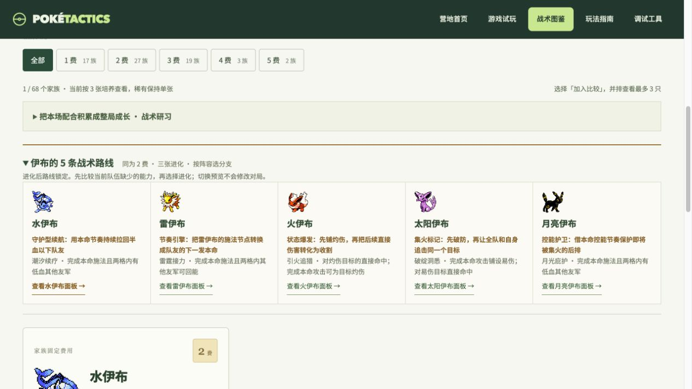

# 战术特性、伊布分支与本局研习

2026-10-17。本轮在现有 68 家族竞技卡池上改造特性，不改变家族价格和 1 / 3 / 9 张培养规则。第一至四节区分已实现规则与审计发现；第五节为后续设计候选，尚未实现。

## 1. 伊布按阵容缺口选择进化

伊布家族仍为固定 2 费；累计 3 张选择分支，9 张满培养。进化后路线锁定，想转另一条路线需要培养另一组伊布。五条路线并排见 `/pokedex?q=伊布&stage=2`，准备期进化面板同样显示分支特性。

| 分支 | 独立特性与主动条件 | 组队目的 | 主要限制 |
| --- | --- | --- | --- |
| 水伊布 | 潮汐续疗：本命完成后治疗两格内半血以下的其他队友，按目标最大生命 8% | 承伤续航，保护持续输出位 | 排除自疗；需伤员和距离；5 秒冷却，每战 3 次，受封疗影响 |
| 雷伊布 | 雷霆接力：本命完成后为两格内其他队友补至多 10 能量，优先攻击型与接近施法的目标 | 加快核心下一次本命，输出与辅助混编 | 满能、离群或只剩自身无收益；5 秒冷却，每战 3 次 |
| 火伊布 | 引火追猎：本命建立灼伤，对已灼伤目标的直接伤害 +25% | 灼伤追击；自己铺垫或由火系队友提前铺垫 | 铺垫 6 秒冷却、每战 2 次；火属性免疫灼伤，其他主要异常占槽会阻止铺火；DOT 不吃追击加成 |
| 太阳伊布 | 破绽洞悉：本命后给存活目标 4 秒易伤；对已有易伤目标的直接伤害 +15% | 为全队制造集火窗口，自己跟进追击 | 铺垫 5 秒冷却、每战 2 次；不刷新已有易伤；需要后续攻击同一目标 |
| 月亮伊布 | 月光庇护：本命完成后为两格内六成血以下其他队友加最大生命 10% 护盾，持续 3 秒 | 利用本命控能节奏保护脆弱核心 | 5 秒冷却，每战 3 次；不覆盖更强盾；空盾过期不推进研习 |

火伊布和太阳伊布的次数限制约束“铺垫”；目标条件存在期间的直接增伤持续有效，不逐次扣铺垫次数。图鉴把这种差别写进完整特性说明。其他分支只有实际收益才消耗次数。

特性治疗／回能保持独立来源，不冒充本命治疗／回能。因此水伊布的特性治疗不会启动护心铃或甘露坠饰、雷伊布的特性回能不会启动接力线圈；它们可以与专职本命辅助搭配。这样保留装备触发的明确边界，也避免回能与护盾互相递归。

## 2. 本局成长：战术研习

这是队伍本局共享的成长，与跨局挑战解锁分开显示。准备页新增“本局研习”，对手侦查可查看其当前积累。

| 路线 | 产生积累的实际贡献 | 每层收益 | 上限 |
| --- | --- | --- | --- |
| 生存研习 | 水伊布特性有效治疗 | 全队最大生命 +1% | 5 层 / +5% |
| 强攻研习 | 火伊布或太阳伊布特性产生额外实际生命伤害 | 全队攻击与特攻 +1% | 5 层 / +5% |
| 节奏研习 | 雷伊布特性回能、黑暗鸦实际掠能回收、月亮伊布特性盾实际吸收伤害 | 全队开战能量 +1 | 5 层 / +5 能量 |

- 每个真实席位、每回合、每条路线最多增加一层。不按每次触发、每个同种个体或多目标数量叠加。
- 胜负不影响积累。上场角色阵亡前已经产生的贡献仍计入；替补不参与战斗，不提供贡献。
- 本轮战后结算，下轮生效；本轮已经结算的席位被选作镜像时，不会提前携带本轮新收益。
- PvE、PvP 和玩家对镜像的真实战斗都可积累；镜像来源席位不因此重复领奖。
- 出售、合成、进化和更换阵容保留本局队伍积累，新对局清零。无需为了保住面板被迫永久挂一只低费工具人。
- 空治疗、空回能、只放盾未实吸、仅造成额外护盾伤害都不当作对应的有效成长证据。
- 自动保存与导入保存完整账本；刷新和回放不结算。旧存档从零开始研习，不追溯历史奖励。

本轮先用伊布与黑暗鸦作为小规模试点。五层上限意味着早入场只提前达到小幅收益上限，不能无限压过后期阵容。仍需后续整局平衡样本评估“多路线都练满”是否挤压其他阵容，不宣称已达到最终平衡。

## 3. 黑暗鸦与特性审计

黑暗鸦旧“夜食”需要被敌方恶属性直接伤害打中且存活，属于对手决定的低频条件，难以主动配队。现在改为“趁隙掠能”：主动命中带主要异常或易伤的目标，掠取至多 8 敌方能量，自身获得其中一半；无这些条件时，若命中前目标至少有 12 能量，也能小额掠取至多 4 能量并获得其中一半。两档共享 4 秒冷却、每战最多 3 次。必须真的命中扣血或耗盾，并产生实际回能。可和火伊布铺火、太阳伊布标记以及毒／麻痹队配合。

本次审计按四个维度判断：触发权在谁手里、是否符合站位和射程、能否形成可执行的搭配、实际收益是否值得占用阵容位置。没有给全部 151 形态编造强度排名。

| 问题类型 | 当前例子 | 本轮处理／下一步 |
| --- | --- | --- |
| 触发权完全依赖敌人属性 | 旧黑暗鸦、导电／避雷针／蓄水等 | 黑暗鸦改主动联动；其他属性吸收可保留为环境针对，但需测触发率后决定是否给基础收益 |
| 特性触发距离和角色射程错配 | 旧雷伊布的邻格受击静电、远程反击型特性 | 雷伊布改主动回能；其他远程反击按前排替代定位逐个复核 |
| 只有被动数值，缺少玩家决策 | 旧月亮伊布定时自疗 | 改保护低血队友，站位和施法频率决定价值 |
| 只有消费条件，自己和队友很难铺垫 | 旧太阳伊布易伤追击 | 主动铺易伤，也能消费队友创造的易伤 |
| 理论存在，但系统策略未覆盖 | 部分装备的机器人配装、部分家族的技能机相容面 | 检查现有接入并修复实证缺口，优先于继续堆数量 |

特性越复杂不等于越好。基础牌可以保留“结实”等一眼能懂的能力；战术核心需要清晰的启动、收益与反制。审计不把条件窄直接等同于数值弱，也不根据单一胜率就统一加强。

## 4. 道具与技能机：先补接口

当前竞技目录有 30 件装备、18 种技能机。每只仍只有一个装备位和一个学习位，特性不占这两个位置。

现有组件共 8 种，36 种无序两两组合中 32 种已有配方。无限扩充成品会挤占配方与掉落；应先改善获取、相容性、推荐和实际触发。界面关于技能机“每战仅一次”的旧文案已修正为培养档次数与 3 次有效普攻再装填，天气机仍每战一次，具体以各机说明为准。

本轮已补齐 18 件竞技专用装备的机器人合成优先级，为其中原先缺失的 7 件增加载体评分。选择「强行」的尼多王不会再被分配扩散宝珠；火伊布可用自己施加的灼伤，在满足三次真实跳伤后启动扩散。装备对玩家的合法性与配方不变。

技能机当前主要空缺是灼伤铺垫、易伤铺垫和控能，不能只补三个更高威力招式。按真实相容规则逐项检查，黑暗鸦和月亮伊布目前都只能学习「睡觉」。这是明确的选择面缺口，后续优先设计适合恶属性的易伤或控能机器，而非直接放开全部高威力招式。

## 5. 后续候选（尚未实现）

| 优先级 | 候选 | 有意义的取舍 | 落地前需要验证 |
| --- | --- | --- | --- |
| 1 | 鬼火技能机：低伤害／无直接伤害，稳定尝试施加灼伤 | 放弃额外爆发，换火伊布和异常队的前置条件 | 火免疫、占槽、净化、合法学习范围，以及是否抢走火伊布特色 |
| 2 | 假哭技能机：为一名敌人铺短易伤 | 本身收益低，依赖队友同时集火 | 不叠加／不无限续时；与太阳伊布本命及特性的差异 |
| 3 | 能量压制技能机：有限扣能，不直接给自己等额返能 | 用学习位延后敌方本命，牺牲伤害机器 | 低能量无收益不耗次数、再装填、是否形成封锁施法循环 |
| 4 | 特性联动装备：有限接受“特性来源”的有效治疗或回能 | 花唯一装备位放大某条路线，放弃输出／生存装 | 独立冷却与次数，只消费实际收益，产物不能再次触发自身 |
| 5 | 后续成长型特性：天气观测、破阵演练、逆风经验 | 晴雨争夺、真实位移或逆风坚持形成不同积累方式 | 队伍共享还是个体持有、上限与追赶、不能靠挂机和复制刷层 |

新道具与技能机不在本轮新增；先确认五分支和研习带来的决策是否有趣，再逐项引入这些接口，避免同时改变过多变量。

## 6. 验证与证据

固定满培养阵容，每只焦点精灵面对 3 组对手，各跑 20 个种子，并与「仅关闭焦点自己的特性」作对照，共 720 场模拟。各分支采用不同适配队友，不能横向把胜场当强度排名。完整阵容、种子范围、规则指纹及统计见 [特性对照数据](evidence/tactical-traits-n20.json)，复跑命令：

```sh
python3 tools/acceptance/tactical_trait_probe.py --seeds 20 --output .build/arena-probe/tactical-traits-final-n20.json
```

| 焦点精灵 | 有效触发场数 / 开启组场数 | 60 场累计实际收益 | 开启 / 关闭特性胜场 |
| --- | ---: | --- | ---: |
| 水伊布 | 60 / 60 | 治疗 2418 | 42 / 41 |
| 雷伊布 | 60 / 60 | 队友回能 600 | 60 / 60 |
| 火伊布 | 35 / 60 | 自身额外生命伤害 673 | 55 / 47 |
| 太阳伊布 | 44 / 60 | 易伤 44 次；自身额外生命伤害 69 | 40 / 40 |
| 月亮伊布 | 6 / 60 | 给盾 234；实际吸收 63 | 60 / 60 |
| 黑暗鸦 | 60 / 60 | 自身实际回能 482 | 22 / 22 |

这是触发与收益抽样，不是排位胜率。月亮伊布样本中己方优势大，低血护盾窗口少，不能据此直接加强；太阳伊布给全队带来的易伤收益也未全部归入它自己的额外伤害。火伊布对照有明显增益，后续扩大对手和装备组合，继续检查其上限。

新版 `families_v2` 另跑 10 个完整八人对局，共 1126 场战斗，全部结束且期末存档往返一致，研习无越过 5 层。该批机器人阵容实际积累生存 5 层、节奏 32 层、强攻 0 层；强攻的有效伤害结算由专项战斗测试覆盖，不能把这批整局样本称为三路线都已充分验证。[整局证据](evidence/tactical-research-family-n10.json) 可用以下命令复跑：

```sh
python3 tools/acceptance/tactical_research_probe.py --games 10 --seed-base 2026101710 --output .build/arena-probe/tactical-research-family-n10.json
```

回归包含当前／前任存档、成长上限与结算幂等、PvE／PvP／镜像、同轮收益延后生效、实际治疗与吸盾归因、五分支目录与主站接口。交叉审查补上两个边界：黑暗鸦低档门槛读取命中前能量（11 不触发、12 触发），火伊布的灼伤文案与火色表现保持一致。

最终竞技回归 699 项通过；图鉴、前三世代目录、保存及战术统计集成另 28 项通过；三个改动的 JavaScript 文件语法检查与 Git diff 检查通过。

```sh
python3 -m unittest discover -s tests -p 'test_arena*.py'
python3 -m unittest tests.test_portal_family_catalog tests.test_gen123_expansion tests.test_session_save tests.test_tactical_trait_catalog_integration -q
node --check tools/acceptance/family_dex.js
node --check tools/acceptance/hub.js
node --check tools/acceptance/play.js
git diff --check
```

页面验收覆盖五分支预览切换、默认分支选中、特性搭配／反制卡、本局研习三轨进度，以及五个战前标签的键盘循环。主站仍为 `http://127.0.0.1:8813`；更新前备份已有存档，并只读确认近期旧存档可恢复。


